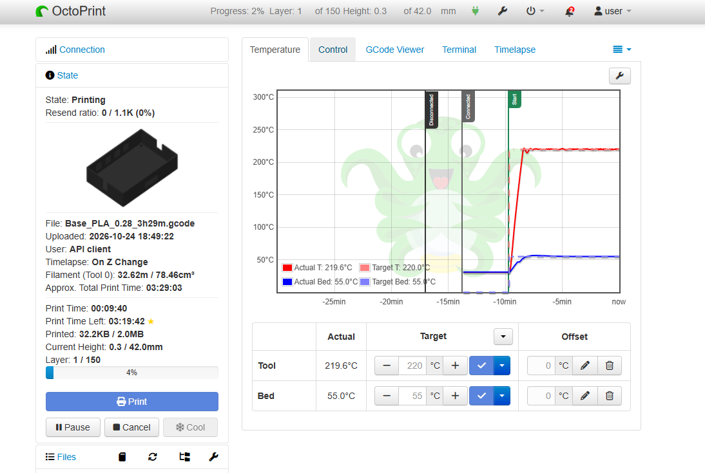
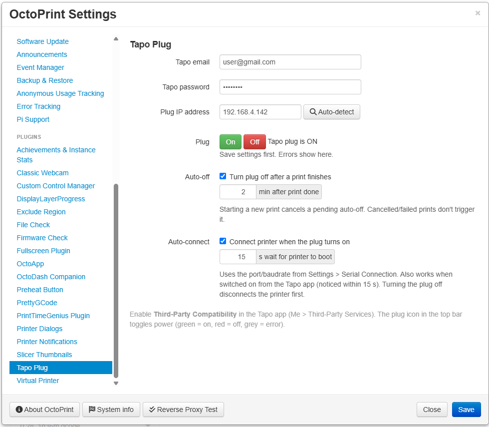
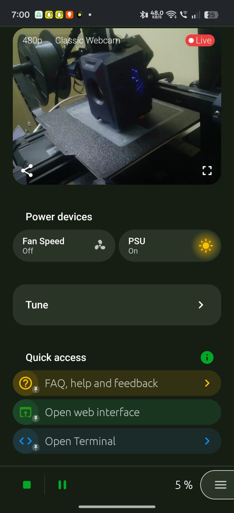

# OctoPrint Tapo Plug

Control your printer's power with a **TP-Link Tapo smart plug** (P110, P100, P115…) straight from OctoPrint.
Standalone: no PSU Control, no Home Assistant, no cloud: talks to the plug on your local network.



## Features

- **One-click power** – plug icon in the top bar: green = on, red = off, grey = error. Click to toggle.
- **Auto-detect** – scans your network and lists Tapo plugs; click one to use it.
- **Auto-off after print** – turn the printer off *N* minutes after a print finishes. Starting a new print cancels it.
- **Auto-connect** – when the plug turns on (from OctoPrint, the Tapo app or the plug's button) OctoPrint connects to the printer by itself.
- **Clean shutdown** – disconnects the printer before cutting power, so no serial errors.
- **OctoDash & OctoApp** – their power buttons work out of the box (this plugin speaks PSU Control's API).
- **New Tapo firmware** – supports TPAP, KLAP and AES; works where UDP discovery doesn't.
- **Updates** via OctoPrint's Software Update.

## Requirements

- OctoPrint on **Python 3.11+** (OctoPi 1.1 or newer). Check: Settings > About > System info.
- Tapo app: **Me > Third-Party Services > Third-Party Compatibility = ON**.
- Plug and Raspberry Pi on the same network (no guest network / client isolation).

## Install

OctoPrint > Settings > Plugin Manager > **Get More** > *…from URL*:

```
https://github.com/sudo-atharva/OctoPrint-PSUControl-Tapo/archive/main.zip
```

Restart OctoPrint.

## Setup

1. Settings > **Tapo Plug**.
2. Enter your Tapo app email and password.
3. Click **Auto-detect**, pick your plug (or type its IP), **Save**.
4. Press **On** / **Off** to test. Any error is shown next to the buttons.



| Option | Default | What it does |
|---|---|---|
| Auto-off | off | Turn the plug off this many minutes after a print finishes |
| Auto-connect | on | Wait this many seconds after the plug turns on, then connect the printer (uses Settings > Serial Connection) |

Top bar icon (green = on):


## OctoDash / OctoApp

Nothing extra to install. The plugin answers [PSU Control](https://github.com/kantlivelong/OctoPrint-PSUControl)'s API, so:

- **OctoDash**: in its settings enable the **PSU Control** power option.
- **OctoApp**: detected automatically; the power menu shows the plug.

**Don't install the real PSU Control at the same time**; both use the `psucontrol` plugin id.

OctoApp shows the plug as **PSU** under *Power devices*:



## Troubleshooting

| Error | Cause / fix |
|---|---|
| `OSError(113)` / *No route to host* | The Pi can't reach the plug on the network. Check router client/AP isolation, guest network, and give the plug a fixed IP (DHCP reservation). Disabling Wi-Fi power saving on the Pi helps: `sudo iw wlan0 set power_save off` |
| `ACCOUNT_ERROR` / login failed | Wrong email/password, or the plug locked local login after several wrong tries. Wait ~5 minutes or power-cycle the plug. |
| `TRANSPORT_UNKNOWN_CREDENTIALS_ERROR`, handshake 403 | Third-Party Compatibility is off in the Tapo app. |
| Auto-detect finds nothing | Only the Pi's own /24 subnet is scanned. Enter the IP by hand (Tapo app > plug > Device Info). |

Logs: Settings > Logging > `octoprint.log` (lines with `psucontrol_tapo`).

## How it works

Uses [python-kasa](https://github.com/python-kasa/python-kasa). Newer Tapo firmware uses TPAP encryption, which is only in an unreleased python-kasa build ([PR #1592](https://github.com/python-kasa/python-kasa/pull/1592)); the plugin installs that build. It moves to the released package once TPAP support ships.

`tools/tapo_test.py` is a small command-line tester: `python tools/tapo_test.py <ip> status|on|off` (credentials via `TAPO_USERNAME` / `TAPO_PASSWORD` env vars).

## License

[AGPLv3](LICENSE)
